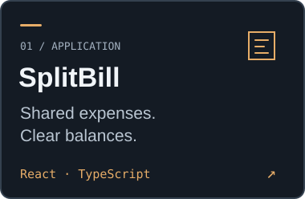
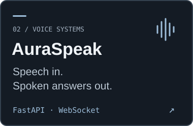

<picture>
  <source media="(max-width: 640px)" srcset="assets/developer-header-mobile.svg" />
  
</picture>

<p align="center">
  <a href="https://DIVYANSH-675.github.io/"><b>Portfolio ↗</b></a> &nbsp; / &nbsp;
  <a href="https://www.linkedin.com/in/divyansh-gupta-b4396a207/">LinkedIn</a> &nbsp; / &nbsp;
  <a href="mailto:divyanshgupta0704@gmail.com">Email</a> &nbsp; / &nbsp;
  <a href="https://github.com/DIVYANSH-675?tab=repositories">All repositories ↗</a>
</p>

I build **ML experiments and full-stack applications** — from a small runnable idea to something I can test, understand, and improve.

<p><a href="#01--applications">Applications ↓</a> &nbsp; · &nbsp; <a href="#02--research-lab">Research lab ↓</a> &nbsp; · &nbsp; <a href="#03--toolkit">Toolkit ↓</a></p>

### `01` / Applications

<p>
  <a href="https://github.com/DIVYANSH-675/splitly"></a>
  <a href="https://github.com/DIVYANSH-675/Auraspeak"></a>
</p>

- **SplitBill** — offline expense records, transfers, activity history, and PDF/XLSX exports. `Android preview`
- **AuraSpeak** — streaming speech recognition, model responses, and audio playback.

**Also building:** [LLM Council ↗](https://github.com/DIVYANSH-675/LLM-Council) — generate, evaluate, and combine responses from multiple agents.

### `02` / Research lab

**Decision making · Geometry · Inverse imaging · Reasoning**

Small, inspectable prototypes. Each repository includes evaluation tools, tests, and documented limitations; the CI links open the actual workflow runs.

| Project | What it explores | Inspect |
| :--- | :--- | :--- |
| **[RiskWeave](https://github.com/DIVYANSH-675/RiskWeave)** | Fuzzy-capacity risk aggregation for constrained RL on navigation tasks. | [CI](https://github.com/DIVYANSH-675/RiskWeave/actions/workflows/ci.yml) |
| **[AstroBridge](https://github.com/DIVYANSH-675/AstroBridge)** | Conditional Brownian bridges for synthetic inverse imaging and ensemble diagnostics. | [CI](https://github.com/DIVYANSH-675/AstroBridge/actions/workflows/ci.yml) |
| **[MoleculeMask](https://github.com/DIVYANSH-675/MoleculeMask)** | Equivariant masked 3D reconstruction and scalar-property prediction on synthetic geometry. | [CI](https://github.com/DIVYANSH-675/MoleculeMask/actions/workflows/ci.yml) |
| **[WeightScope](https://github.com/DIVYANSH-675/WeightScope)** | Invariant Transformer-weight features and grouped checkpoint-quality evaluation. | [CI](https://github.com/DIVYANSH-675/WeightScope/actions/workflows/ci.yml) |
| **[AdaptiveSolve](https://github.com/DIVYANSH-675/AdaptiveSolve)** | Routing bounded arithmetic tasks between direct answers and programs, with repair traces. | [CI](https://github.com/DIVYANSH-675/AdaptiveSolve/actions/workflows/ci.yml) |

<details>
<summary><b>More experiments</b> — language adaptation and maritime data</summary>

- **[FOMC GPT-2](https://github.com/DIVYANSH-675/fomc-gpt2-btp2)** — domain adaptation with financial text.
- **[Maritime ML](https://github.com/DIVYANSH-675/ais-ml-pipeline-detection)** — anomaly analysis and ship classification using AIS data.

</details>

### `03` / Toolkit

```python
experiments = ["Python", "PyTorch", "NumPy", "pandas", "scikit-learn"]
applications = ["TypeScript", "React", "FastAPI", "SQL"]
workflow = ["Git", "Linux", "pytest", "GitHub Actions"]
```

> Start with a baseline. Examine the failures. Keep the next change measurable.

---

**Have a problem worth building for?** [Let's talk ↗](mailto:divyanshgupta0704@gmail.com)
