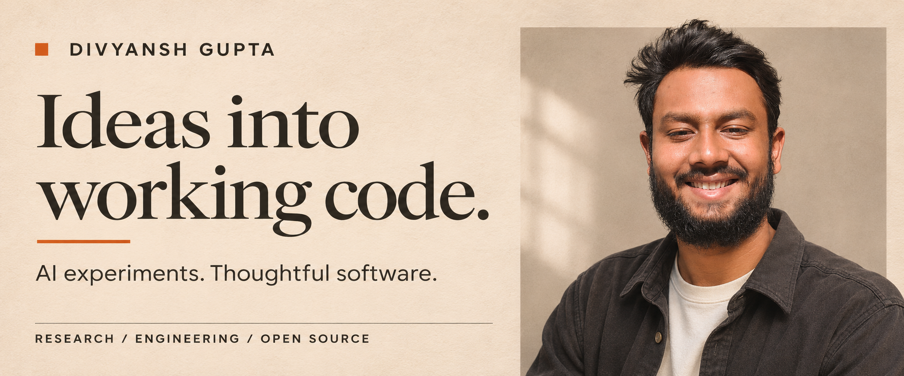

  <a href="https://DIVYANSH-675.github.io/">Portfolio ↗</a> &nbsp;&nbsp; · &nbsp;&nbsp;
  <a href="https://www.linkedin.com/in/divyansh-gupta-b4396a207/">LinkedIn ↗</a> &nbsp;&nbsp; · &nbsp;&nbsp;
  <a href="mailto:divyanshgupta0704@gmail.com">Say hello ↗</a>

 

I’m **Divyansh**. I build machine-learning experiments and software for everyday problems. I like projects where there’s something to understand deeply, something to test, and something useful to make.

My current work explores reinforcement learning, geometric models, inverse imaging, and reasoning systems.

 

## Selected work

<table>
<tr>
<td width="50%" valign="top">
01 &nbsp; / &nbsp; APPLICATIONS
<h3><a href="https://github.com/DIVYANSH-675/splitly">SplitBill ↗</a></h3>

A shared-expense app for keeping track of bills, transfers, and who owes what. Built with offline records, activity history, and PDF/XLSX exports.

TypeScript · React · Android preview

</td>
<td width="50%" valign="top">
02 &nbsp; / &nbsp; REINFORCEMENT LEARNING
<h3><a href="https://github.com/DIVYANSH-675/RiskWeave">RiskWeave ↗</a></h3>

An experiment in combining multiple risk signals for constrained RL. Includes fuzzy-capacity aggregation, navigation tasks, and seeded evaluation.

Python · PyTorch · Research prototype

</td>
</tr>
<tr>
<td width="50%" valign="top">
03 &nbsp; / &nbsp; INVERSE IMAGING
<h3><a href="https://github.com/DIVYANSH-675/AstroBridge">AstroBridge ↗</a></h3>

Exploring image recovery with conditional Brownian bridges. Synthetic imaging experiments, residual training, and ensemble diagnostics.

Python · PyTorch · Research prototype

</td>
<td width="50%" valign="top">
04 &nbsp; / &nbsp; GEOMETRIC LEARNING
<h3><a href="https://github.com/DIVYANSH-675/MoleculeMask">MoleculeMask ↗</a></h3>

Learning from masked 3D geometry through equivariant coordinate reconstruction and scalar-property prediction on synthetic data.

Python · PyTorch · Research prototype

</td>
</tr>
<tr>
<td width="50%" valign="top">
05 &nbsp; / &nbsp; MODEL ANALYSIS
<h3><a href="https://github.com/DIVYANSH-675/WeightScope">WeightScope ↗</a></h3>

Investigating what Transformer weights reveal about checkpoint quality, with invariant features and grouped baseline evaluation.

Python · Checkpoint analysis · Research prototype

</td>
<td width="50%" valign="top">
06 &nbsp; / &nbsp; REASONING SYSTEMS
<h3><a href="https://github.com/DIVYANSH-675/AdaptiveSolve">AdaptiveSolve ↗</a></h3>

A controller for routing arithmetic tasks between direct answers and programs, with bounded execution and inspectable repair traces.

Python · Program interpretation · Research prototype

</td>
</tr>
</table>

Research repositories include evaluation tools, tests, and documented limitations.

 

## On the workbench

I start with a small runnable idea, compare it with a baseline, and look closely at the failures. The next iteration should have a clear reason to exist.

A few other directions I’ve explored:

- **[LLM Council](https://github.com/DIVYANSH-675/LLM-Council)** — generating, evaluating, and combining responses from multiple agents.
- **[AuraSpeak](https://github.com/DIVYANSH-675/Auraspeak)** — streaming speech recognition, model responses, and voice playback.
- **[Maritime ML](https://github.com/DIVYANSH-675/ais-ml-pipeline-detection)** — anomaly analysis and ship classification with AIS data.
- **[FOMC GPT-2](https://github.com/DIVYANSH-675/fomc-gpt2-btp2)** — domain adaptation experiments with financial text.

 

## Everyday tools

**Experiments** &nbsp; Python / PyTorch / NumPy / pandas / scikit-learn 
**Applications** &nbsp; TypeScript / React / FastAPI / SQL 
**Workflow** &nbsp; Git / Linux / pytest / GitHub Actions

 

---

### Have an interesting problem in mind?

I’d like to hear about it. **[Get in touch ↗](mailto:divyanshgupta0704@gmail.com)**

Portrait and notebook artwork created with AI. Portrait based on my own photograph.
