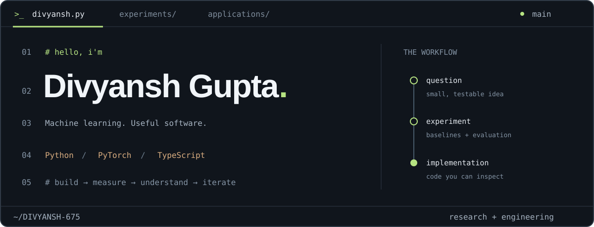

<p align="center">
  <a href="https://DIVYANSH-675.github.io/"><b>Portfolio ↗</b></a> &nbsp; / &nbsp;
  <a href="https://www.linkedin.com/in/divyansh-gupta-b4396a207/">LinkedIn</a> &nbsp; / &nbsp;
  <a href="mailto:divyanshgupta0704@gmail.com">Email</a> &nbsp; / &nbsp;
  <a href="https://github.com/DIVYANSH-675?tab=repositories">Repositories</a>
</p>

I build **ML experiments and full-stack applications**. My current work explores risk-aware decision making, geometric learning, inverse imaging, and reasoning systems.

### `01` / Applications

**[SplitBill ↗](https://github.com/DIVYANSH-675/splitly)** &nbsp; `TypeScript` `React` `Android preview`<br>
Shared expenses, transfers, and balances, with offline records, activity history, and PDF/XLSX exports.

**[AuraSpeak ↗](https://github.com/DIVYANSH-675/Auraspeak)** &nbsp; `Python` `FastAPI` `WebSocket`<br>
A streaming voice pipeline connecting speech recognition, model responses, and audio playback.

**[LLM Council ↗](https://github.com/DIVYANSH-675/LLM-Council)** &nbsp; `Multi-agent systems`<br>
Generate, evaluate, and combine responses from multiple agents.

### `02` / Research lab

Small, inspectable prototypes with evaluation tools, tests, and documented limitations.

| Project | What it explores | Inspect |
| :--- | :--- | :--- |
| **[RiskWeave](https://github.com/DIVYANSH-675/RiskWeave)** | Fuzzy-capacity risk aggregation for constrained RL on navigation tasks. | [CI](https://github.com/DIVYANSH-675/RiskWeave/actions/workflows/ci.yml) |
| **[AstroBridge](https://github.com/DIVYANSH-675/AstroBridge)** | Conditional Brownian bridges for synthetic inverse imaging and ensemble diagnostics. | [CI](https://github.com/DIVYANSH-675/AstroBridge/actions/workflows/ci.yml) |
| **[MoleculeMask](https://github.com/DIVYANSH-675/MoleculeMask)** | Equivariant masked 3D reconstruction and scalar-property prediction on synthetic geometry. | [CI](https://github.com/DIVYANSH-675/MoleculeMask/actions/workflows/ci.yml) |
| **[WeightScope](https://github.com/DIVYANSH-675/WeightScope)** | Invariant Transformer-weight features and grouped checkpoint-quality evaluation. | [CI](https://github.com/DIVYANSH-675/WeightScope/actions/workflows/ci.yml) |
| **[AdaptiveSolve](https://github.com/DIVYANSH-675/AdaptiveSolve)** | Routing bounded arithmetic tasks between direct answers and programs, with repair traces. | [CI](https://github.com/DIVYANSH-675/AdaptiveSolve/actions/workflows/ci.yml) |

<details>
<summary><b>More experiments</b> — language adaptation and maritime data</summary>

- **[FOMC GPT-2](https://github.com/DIVYANSH-675/fomc-gpt2-btp2)** — domain adaptation with financial text.
- **[Maritime ML](https://github.com/DIVYANSH-675/ais-ml-pipeline-detection)** — anomaly analysis and ship classification using AIS data.

</details>

### `03` / Toolkit

```python
experiments = ["Python", "PyTorch", "NumPy", "pandas", "scikit-learn"]
applications = ["TypeScript", "React", "FastAPI", "SQL"]
workflow = ["Git", "Linux", "pytest", "GitHub Actions"]
```

I start with a runnable baseline, examine the failures, and keep the next change measurable.

---

**Have a problem worth building for?** [Let's talk ↗](mailto:divyanshgupta0704@gmail.com)
