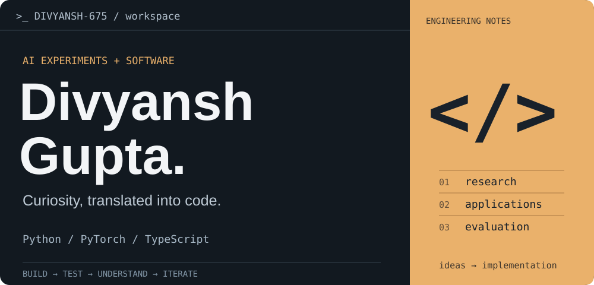
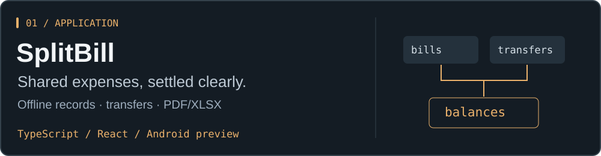
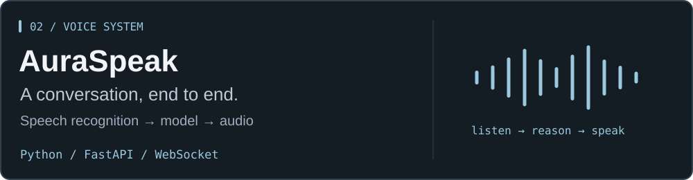
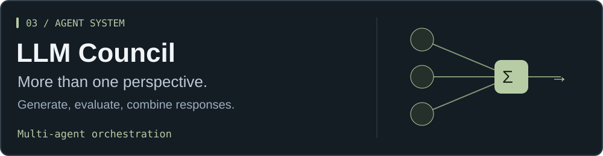
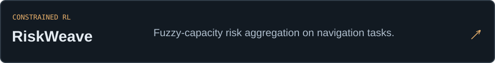
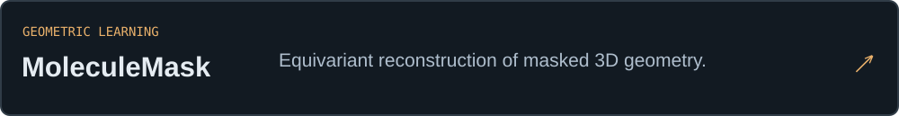
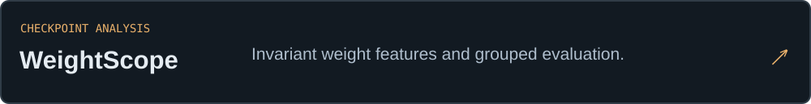
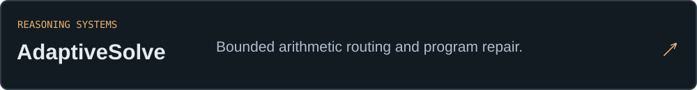

<picture><source media="(max-width: 768px)" srcset="assets/workbench-v3/hero-compact.svg" /></picture>

<p align="center">
  <a href="https://DIVYANSH-675.github.io/"><b>Portfolio ↗</b></a> &nbsp; / &nbsp;
  <a href="https://www.linkedin.com/in/divyansh-gupta-b4396a207/">LinkedIn</a> &nbsp; / &nbsp;
  <a href="mailto:divyanshgupta0704@gmail.com">Email</a> &nbsp; / &nbsp;
  <a href="https://github.com/DIVYANSH-675?tab=repositories">All code ↗</a>
</p>

I build **machine-learning experiments and useful software**. My work explores decision making, geometric models, inverse imaging, and reasoning systems.

### 01 — Applications

<a href="https://github.com/DIVYANSH-675/splitly"><picture><source media="(max-width: 768px)" srcset="assets/workbench-v3/splitbill-compact.svg" /></picture></a>

<a href="https://github.com/DIVYANSH-675/Auraspeak"><picture><source media="(max-width: 768px)" srcset="assets/workbench-v3/auraspeak-compact.svg" /></picture></a>

<a href="https://github.com/DIVYANSH-675/LLM-Council"><picture><source media="(max-width: 768px)" srcset="assets/workbench-v3/council-compact.svg" /></picture></a>

### 02 — Research lab

Runnable prototypes with evaluation tools, tests, and documented limitations.

<a href="https://github.com/DIVYANSH-675/RiskWeave"><picture><source media="(max-width: 768px)" srcset="assets/workbench-v3/riskweave-compact.svg" /></picture></a>

<a href="https://github.com/DIVYANSH-675/AstroBridge"><picture><source media="(max-width: 768px)" srcset="assets/workbench-v3/astrobridge-compact.svg" /></picture></a>

<a href="https://github.com/DIVYANSH-675/MoleculeMask"><picture><source media="(max-width: 768px)" srcset="assets/workbench-v3/moleculemask-compact.svg" /></picture></a>

<a href="https://github.com/DIVYANSH-675/WeightScope"><picture><source media="(max-width: 768px)" srcset="assets/workbench-v3/weightscope-compact.svg" /></picture></a>

<a href="https://github.com/DIVYANSH-675/AdaptiveSolve"><picture><source media="(max-width: 768px)" srcset="assets/workbench-v3/adaptivesolve-compact.svg" /></picture></a>

<details>
<summary><b>Inspect the evaluations and CI</b></summary>

These are research prototypes. The repositories document their datasets, baselines, and limitations.

- [RiskWeave workflow runs](https://github.com/DIVYANSH-675/RiskWeave/actions/workflows/ci.yml)
- [AstroBridge workflow runs](https://github.com/DIVYANSH-675/AstroBridge/actions/workflows/ci.yml)
- [MoleculeMask workflow runs](https://github.com/DIVYANSH-675/MoleculeMask/actions/workflows/ci.yml)
- [WeightScope workflow runs](https://github.com/DIVYANSH-675/WeightScope/actions/workflows/ci.yml)
- [AdaptiveSolve workflow runs](https://github.com/DIVYANSH-675/AdaptiveSolve/actions/workflows/ci.yml)

</details>

<details>
<summary><b>More experiments</b> — language adaptation and maritime data</summary>

- **[FOMC GPT-2](https://github.com/DIVYANSH-675/fomc-gpt2-btp2)** — domain adaptation with financial text.
- **[Maritime ML](https://github.com/DIVYANSH-675/ais-ml-pipeline-detection)** — anomaly analysis and ship classification using AIS data.

</details>

### 03 — Toolkit

```python
experiments  = ["Python", "PyTorch", "NumPy", "pandas", "scikit-learn"]
applications = ["TypeScript", "React", "FastAPI", "SQL"]
workflow     = ["Git", "Linux", "pytest", "GitHub Actions"]
```

> Start with a baseline. Examine the failures. Keep the next change measurable.

---

**Have a problem worth building for?** [Let's talk ↗](mailto:divyanshgupta0704@gmail.com)
