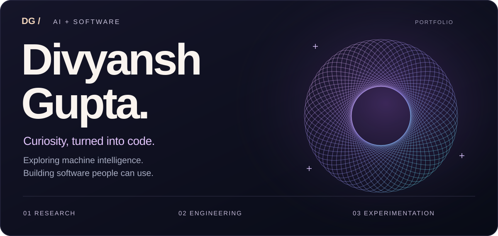
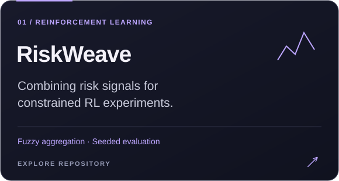
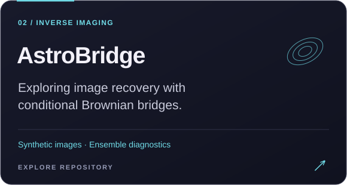
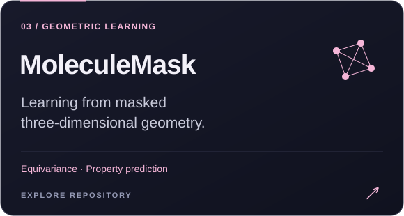
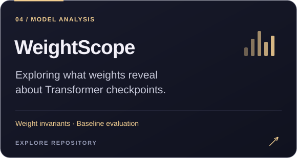
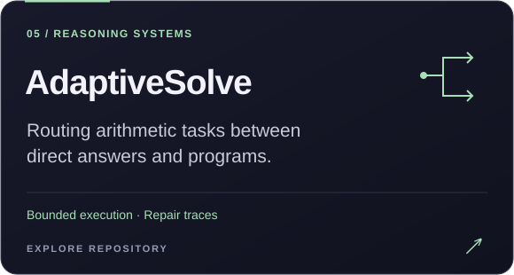
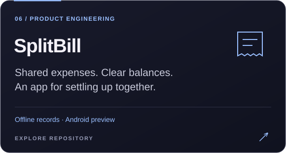
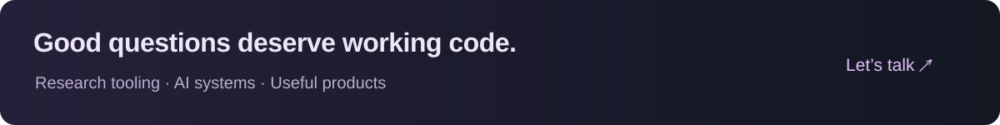

  

  
  
  

 

### A little about my work

I build **AI/ML experiments and practical software**—from constrained reinforcement learning and geometric models to reasoning tools and Android apps. I care about understanding the idea, making it runnable, and testing where it breaks.

 

### Selected work &nbsp; / &nbsp; Research meets engineering

Five research prototypes and one practical product. Open a card to explore the code, experiments, and documentation.

  
  
  
  
  
  

The research projects are exploratory implementations with documented baselines and limitations. SplitBill is available as an Android preview.

 
 

### Beyond the featured six

**[LLM Council](https://github.com/DIVYANSH-675/LLM-Council)** — generating, evaluating, and synthesizing multiple agents' responses. 
**[AuraSpeak](https://github.com/DIVYANSH-675/Auraspeak)** — streaming speech, language-model responses, and voice playback. 
**[Maritime ML](https://github.com/DIVYANSH-675/ais-ml-pipeline-detection)** — exploring anomalies and ship classification in AIS data. 
**[FOMC GPT-2](https://github.com/DIVYANSH-675/fomc-gpt2-btp2)** — experimenting with domain adaptation for financial text.

 

### The toolkit

| Modeling & experiments | Applications & interfaces | Engineering & validation |
| :--- | :--- | :--- |
| Python · PyTorch · NumPy | TypeScript · React · FastAPI | Git · Linux · GitHub Actions |
| pandas · scikit-learn | SQL · Android | pytest · Reproducible runs |

 

**My approach:** start small → establish a baseline → test the edge cases → document the evidence → improve.

 

